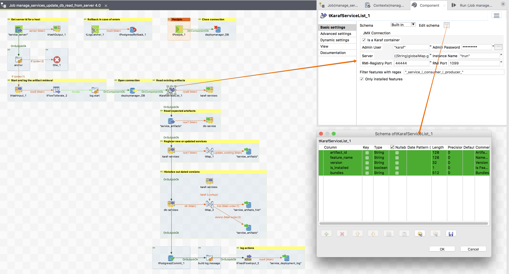
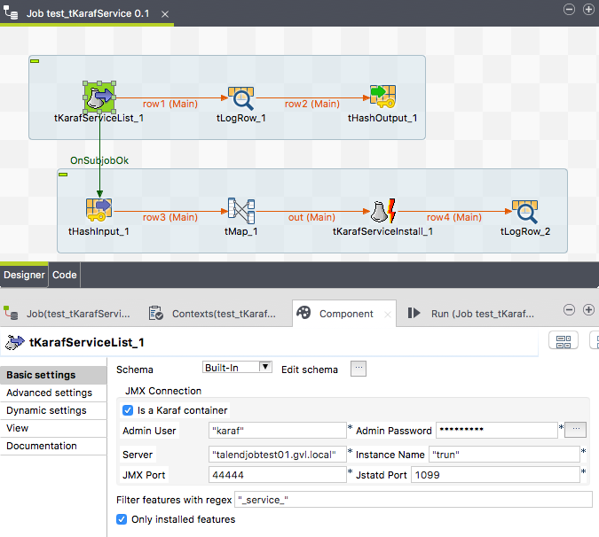
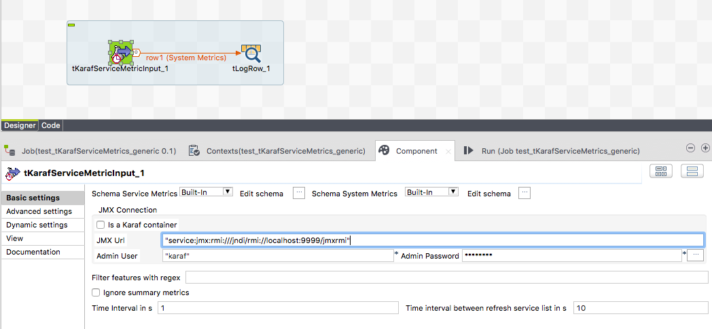

# Components to handle Talend or Talaxie based web services in a Karaf container
Deployment of Talend services made by the TAC in a Karaf-Container in a reliable and efficient way.

|Component               |Purpose                                                                                      |
|------------------------|---------------------------------------------------------------------------------------------|
|tKarafServiceInstall    |install a service (the complete feature) and take care to have only one bundle version active|
|tKarafServiceList       |List the services in a Karaf container (Talaxie or Talend Runtime)                           | 
|tKarafServiceMetricInput|Various metrics of the services like number calls and durations                              |

## Some example jobs:
### tKarafServiceList

### tKarafServiceInstall

### tKarafServiceMetricInput

